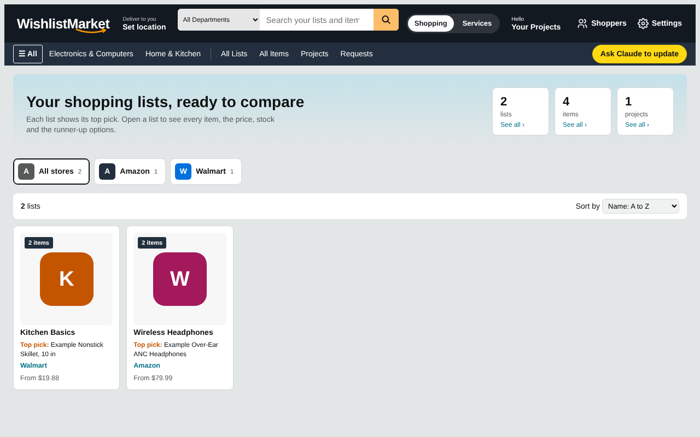
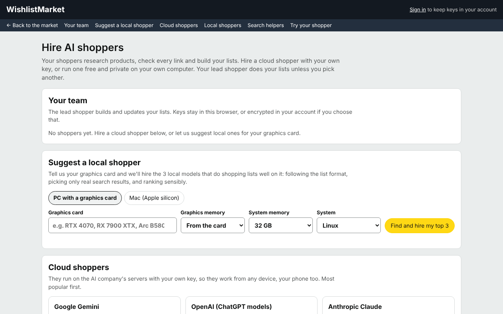

# WishlistMarket

WishlistMarket turns shopping research into clean, comparable lists. Each list holds ranked picks with prices, stock status, pros and cons, a value score and the runner-up options, shown in a familiar store-style layout with departments, store tabs and sorting. A Services side does the same for local providers such as vets, dentists or plumbers.

Lists are built and refreshed by AI shoppers that you "hire" with your own key: Gemini, OpenAI, Claude, Grok, Perplexity, OpenRouter, DeepSeek, Mistral, Groq or Ollama Cloud, or a free local model (Ollama, LM Studio) running in your own browser. A built-in helper looks at your graphics card and suggests the three local models that fit it best. Every pick is link-checked, and shoppers may only choose from real search results, so lists don't fill up with made-up products. There is no shared AI key: user accounts store each person's own key encrypted, and agent tokens let a user's own AI agent edit their lists.

Built with plain HTML and JavaScript on Cloudflare Pages, Pages Functions and D1.

## Repo guide

- `public/` is the site: `index.html`, `data.json` (a small sample data set; put your own snapshot here, with any photos under `img/`). `_headers` asks search engines not to index it.
- `functions/api/[[path]].js` + `app.js`, `lib.js`, `agent.js`, `providers/` and `search/` serve the AI backend under `/api/` (providers, shoppers, key-check, models, ask, search, agent/find-products, agent/rebuild-list, agent/finish). There is no shared AI key: each user sends their own key in the `X-AI-Key` header, or saves it in their account.

Deploy from the repo root (so `functions/` is picked up):

    npx wrangler pages deploy public --project-name wishlistmarket --branch main

Or connect the repo in Cloudflare Pages with no build command and build output directory `public`.

## Accounts

`accounts/accounts.js` adds user accounts at `/api/auth/*`, `/api/me/*` and `/api/data/*`: email and password sign-in (HttpOnly cookie), each user's own lists and projects, their own AI key (stored encrypted), and agent tokens (`Authorization: Bearer wm_...`) so a user's own AI agent can read or edit their lists. The page is `/account`. Route list and settings are at the top of `accounts/accounts.js`.

- Storage: D1 database `wishlistmarket-accounts`, bound as `DB` in `wrangler.toml` (create it with `npx wrangler d1 create wishlistmarket-accounts` and put its id there). Tables: `accounts/schema.sql` (safe to re-run: `npx wrangler d1 execute wishlistmarket-accounts --remote --file accounts/schema.sql`).
- Secret `ACCOUNTS_SECRET` (32+ random characters) encrypts saved AI keys. Without it accounts work but keys can't be saved. Optional vars: `SIGNUPS` (`open`, `invite`, `closed`) and secret `INVITE_CODE`.
- Tests: `node --test accounts/test.js` (Node 22+).
- Local run: put `ACCOUNTS_SECRET=...` in `.dev.vars`, run the schema with `--local`, then `npx wrangler pages dev`.

The public lists on the home page come from `public/data.json`, which in this repo holds sample data only.

## AI shoppers (`/hire`)

Users "hire" AI shoppers on `/hire` (`public/hire.html`, `public/shoppers/hire.js`). Every shopper uses the user's own key; there is still no shared key.

- **Cloud shoppers** (`providers/`): Gemini, OpenAI, Anthropic Claude, xAI Grok, Perplexity and OpenRouter search the web themselves. DeepSeek, Mistral, Groq, Ollama Cloud and "Other online server" (any OpenAI-compatible https server, address in `X-AI-Base-URL`) shop with a **search helper**.
- **Search helpers** (`search/index.js`): Tavily (free 1,000 searches a month), Brave, Perplexity Search, Ollama web search. The user's search key goes in `X-Search-Key` + `X-Search-Provider`, or is saved in the account as `search-<id>`. Ollama Cloud's own key also runs Ollama web search.
- **Local shoppers** (`public/shoppers/local.js`): Ollama, LM Studio and other local OpenAI-compatible servers run in the user's browser, because the server can't reach their computer. The browser calls the model on `localhost`, searches through `POST /api/search`, and `POST /api/agent/finish` link-checks the picks and makes the list. Ollama needs `OLLAMA_ORIGINS=https://wishlistmarket.pages.dev`; LM Studio needs Enable CORS and a context of 16K or more. Setup steps per OS are on the page.
- **Suggest a local shopper** (`public/shoppers/catalog.js`, also `GET /api/shoppers/suggest?gpu=&vram=&ram=&mac=1`): matches the graphics card (NVIDIA, AMD, Intel Arc, Apple silicon, Strix Halo, DGX Spark) to the local models that fit in its memory and do the shopping job well, and hires the top 3 as Lead shopper, Second opinion and Quick shopper. AMD RX 6000 on Windows and Intel Arc get LM Studio (Vulkan); the rest get Ollama.
- The shopping job is shared by server and browser in `public/shoppers/pipeline.js`: prompts, schemas, helper-search research (the model may only pick search results; invented links are fixed or dropped) and the list-rebuild rules.

New routes: `GET /api/shoppers`, `GET /api/shoppers/suggest`, `POST /api/search`, `GET /api/search/key-check`, `POST /api/agent/finish`. `POST /api/search` and `/api/agent/finish` are rate-limited per IP when the D1 database is bound.

Researched 2026-10-29 against each provider's own API docs and pricing pages (platform.openai.com, docs.anthropic.com / platform.claude.com, docs.x.ai, docs.perplexity.ai, openrouter.ai/docs, api-docs.deepseek.com, docs.mistral.ai, console.groq.com/docs, docs.ollama.com, lmstudio.ai/docs, docs.tavily.com, brave.com/search/api) plus live calls: every endpoint was probed with a fake key and answered "invalid key" in the shape the adapters expect, and the default model ids were checked against the live OpenRouter and Ollama Cloud model lists. Local model sizes come from the Ollama library (every suggested tag exists there); fit and quality picks were cross-checked with ctaio.dev, insiderllm.com and llmconfigurator.com hardware guides.

Tests: `node --test test.js shoppers.test.js accounts/test.js` (offline, fake APIs). Browser test of the Hire page: `node e2e/hire.mjs` (Playwright + Chromium; set `SHOTS=dir` for screenshots).
